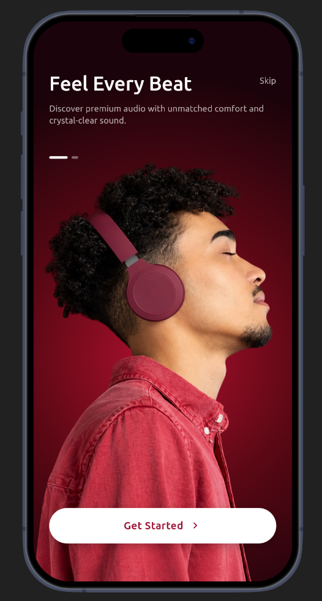
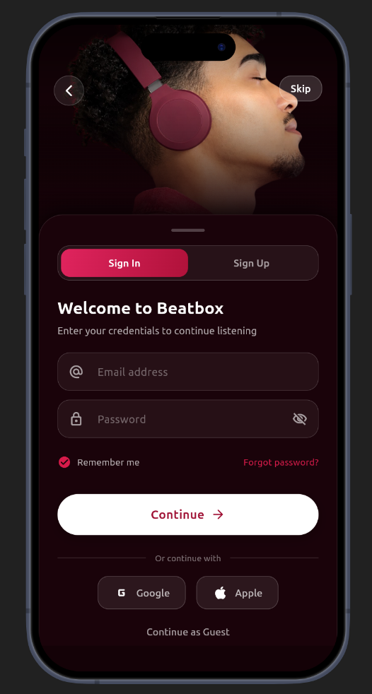
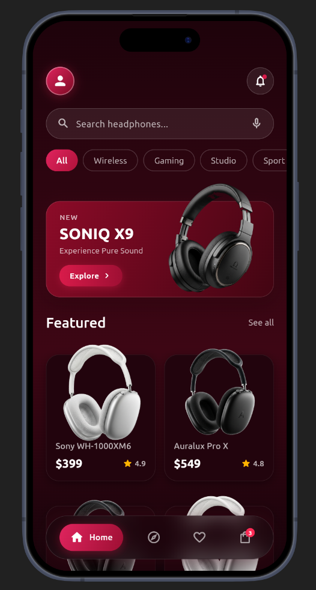
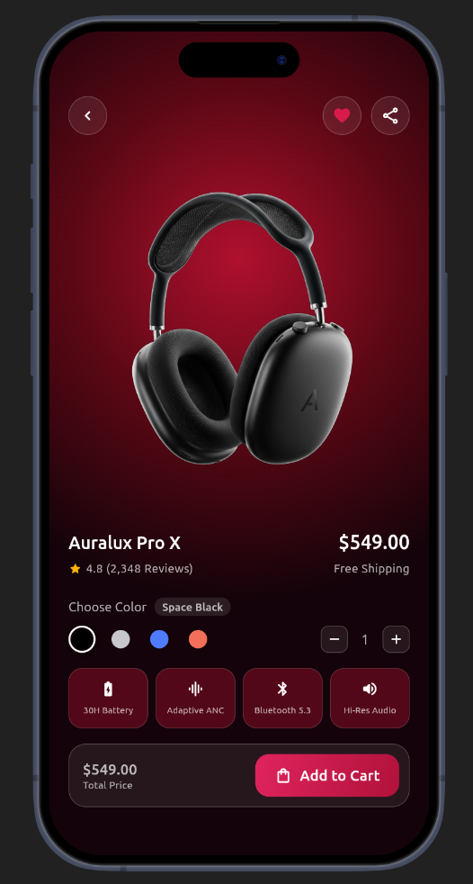

# Beatbox — Premium Audiophile & Headphone E-Commerce Mobile App

A **next-generation luxury audio e-commerce mobile application** built with Flutter and Dart, featuring curated flagship audiophile headphones, interactive sound category exploration, immersive product showcase with dynamic color variations, real-time shopping cart and coupon engine, reactive wishlist, and personal acoustic profile settings.

---

## Features

- **Curated Prestige Audio Catalog** – Hand-picked showcase of industry-leading headphones (Sony WH-1000XM6, Auralux Pro X, Auralux Studio, Auralux Air) featuring high-resolution imagery, verified user ratings, and live pricing.
- **Interactive Multi-Category Discovery** – Dynamic audio explorer with instant search and category filtering across specialized listening modes (*Noise Cancelling*, *Studio Master*, *Bass Boost*, *Wireless Hi-Res*, and *Gaming 3D*).
- **Immersive Product Detail Showcase** – Rich product page with real-time color variant switching (*Space Black*, *Silver White*, *Sky Blue*, *Sunset Coral*), interactive color-matrix shifts, key specifications grid (30H Battery, Adaptive ANC, Bluetooth 5.3, Hi-Res Audio), and quantity steppers.
- **Centralized Shopping Cart & Promo Engine** – Fluid cart management with real-time quantity adjustments, live subtotal calculations, interactive discount voucher application (e.g., `BEAT20` for 20% off), and animated checkout success dialog.
- **Reactive Favorites Wishlist** – Instant heart toggle bookmarking with live state synchronization across screens and elegant empty-state illustrations with quick explore redirects.
- **Audiophile Profile & Acoustic Hub** – Dedicated user dashboard featuring custom Sound Equalizer presets (*Flat*, *Bass Boost*, *Vocal*, *3D Club*), Spatial Audio and Lossless Audio toggles, order history tracking, and security preferences.
- **Onboarding & Fluid Authentication** – Engaging welcome experience with smooth slide transitions, interactive morphing CTA buttons, and integrated authentication modal.
- **Modern Floating Navigation Bar** – Custom floating glassmorphic navigation dock with fluid micro-interactions, badge counters, and smooth page transitions.
- **Deep Crimson Luxury Aesthetic** – Bespoke dark bordeaux palette, glassmorphism cards, refined typography, zero layout overflow, and native Material 3 design system.

---

## Technologies Used

- **Flutter SDK** – Cross-platform framework for crafting native, high-performance mobile experiences.
- **Dart** – Clean, modern, strongly-typed programming language powering the application architecture and UI.
- **ChangeNotifier & AppState** – Centralized reactive state management pattern orchestrating the shopping cart, wishlist, promo codes, and product catalog.
- **Material 3 Design System** – Modern UI standards, custom dark mode styling, and adaptive layout primitives.
- **Glassmorphism & Custom Gradients** – Hand-crafted shaders, backdrop filters, and deep bordeaux gradients for a luxurious auditory ambiance.

---

## Preview

  
  

  
  

